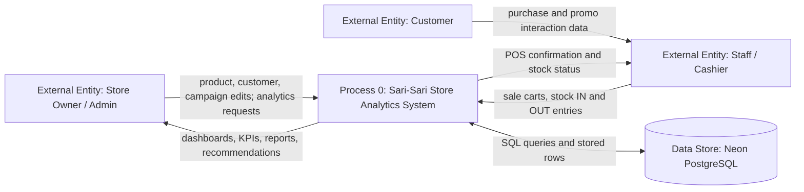

# Data Flow Diagrams (DFD)

## SARI-SARI STORE SALES AND INVENTORY ANALYTICS SYSTEM

Two levels of data flow diagrams are presented: a **Level 0 (context) DFD** and a **Level 1 DFD**. Both use Mermaid `flowchart` syntax with quoted labels for valid rendering.

---

## 1. Level 0 — Context Diagram

The context diagram shows the system as a single process and identifies the external entities that exchange data with it.

**External entities:**

- **Store Owner / Admin** — sends master-data edits and analytics/report requests; receives dashboards, alerts, and recommendations.
- **Staff / Cashier** — sends sale and stock movement data; receives POS confirmation and stock status.
- **Customer** — interacts through the POS; purchase and promo data enter the system via staff entry.
- **Neon PostgreSQL** — the external managed data store for all persistent data.

---

## 2. Level 1 — DFD (Decomposed System)

Level 1 decomposes Process 0 into six major subprocesses and shows the data stores used.

```mermaid
flowchart TB
    Owner["Store Owner / Admin"]
    Staff["Staff / Cashier"]

    D1[("D1: Users")]
    D2[("D2: Products and Categories")]
    D3[("D3: Customers")]
    D4[("D4: Sales and Sale Items")]
    D5[("D5: Inventory Transactions")]
    D6[("D6: Marketing Campaigns")]

    P1["1.0 Authenticate User"]
    P2["2.0 Manage Master Data"]
    P3["3.0 Process POS Sale"]
    P4["4.0 Manage Inventory"]
    P5["5.0 Compute Analytics"]
    P6["6.0 Generate Reports"]

    Owner -->|"credentials"| P1
    Staff -->|"credentials"| P1
    P1 <-->|"user lookup"| D1

    Owner -->|"product, customer, campaign data"| P2
    P2 <-->|"write and read"| D2
    P2 <-->|"write and read"| D3
    P2 <-->|"write and read"| D6

    Staff -->|"cart items, discount, payment"| P3
    P3 <-->|"read price and stock"| D2
    P3 -->|"save sale and items"| D4
    P3 -->|"auto stock OUT"| D5
    P3 -->|"customer lookup or create"| D3

    Staff -->|"stock IN / OUT entries"| P4
    Owner -->|"reorder adjustments"| P4
    P4 <-->|"write and read movements"| D5
    P4 <-->|"update reorder level"| D2

    Owner -->|"analytics request and date range"| P5
    P5 -->|"historical rows"| D4
    P5 -->|"product and cost data"| D2
    P5 -->|"segment data"| D3
    P5 -->|"stock movements"| D5
    P5 -->|"campaign results"| D6
    P5 -->|"KPIs, forecasts, recommendations"| Owner

    Owner -->|"report type and date filter"| P6
    P6 -->|"sales rows"| D4
    P6 -->|"inventory rows"| D5
    P6 -->|"formatted sales / inventory report"| Owner
```

---

## 3. Data Flow Descriptions

| Flow | From → To | Data carried |
|---|---|---|
| Credentials | Owner/Staff → 1.0 | Username and password for authentication |
| Master data | Owner → 2.0 | Product, customer, and campaign fields |
| Cart data | Staff → 3.0 | Product IDs, quantities, discount, payment method |
| Sale records | 3.0 → D4 | `sales` and `sale_items` rows |
| Auto stock OUT | 3.0 → D5 | Inventory transaction with `txn_type = 'OUT'` |
| Stock movements | Staff → 4.0 → D5 | `txn_type`, `quantity`, `reference`, `txn_date`, `note` |
| Analytics inputs | D2–D6 → 5.0 | Historical sales, costs, customers, stock, campaigns |
| Analytics outputs | 5.0 → Owner | Descriptive metrics, predictive forecasts, prescriptive recommendations |
| Report request | Owner → 6.0 | Report type and date range |
| Report output | 6.0 → Owner | Filtered sales and inventory reports |

---

## 4. Notes

- The authenticated user process (1.0) gates all other processes; unauthenticated requests are rejected.
- Process 3.0 writes to both the sales store and the inventory store, ensuring that every POS sale deducts stock.
- Process 5.0 implements the step-wise BA pipeline: it reads descriptive data first, derives predictive outputs, then applies prescriptive rules.
- All data stores in Level 1 are logical views backed by the single Neon PostgreSQL database shown in Level 0.
