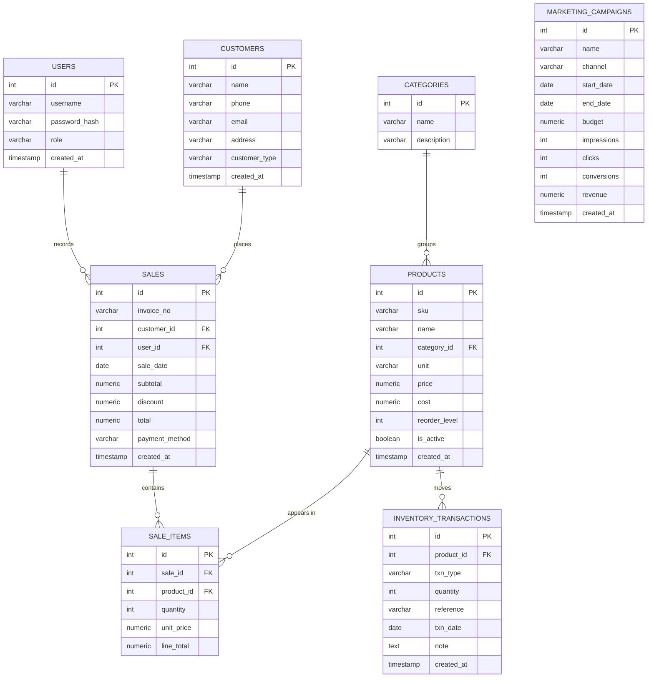

# Entity Relationship Diagram (ERD)

## SARI-SARI STORE SALES AND INVENTORY ANALYTICS SYSTEM

The diagram below shows all database tables and their relationships. It is written in Mermaid `erDiagram` syntax and can be rendered directly in Markdown viewers that support Mermaid.

---

## Relationship Summary

| Relationship | Cardinality | Meaning |
|---|---|---|
| CATEGORIES → PRODUCTS | 1 : many | One category groups many products |
| CUSTOMERS → SALES | 1 : many | One customer can place many sales; a walk-in sale may have no customer |
| USERS → SALES | 1 : many | One user can record many sales |
| SALES → SALE_ITEMS | 1 : many | One sale contains many line items |
| PRODUCTS → SALE_ITEMS | 1 : many | One product can appear in many sale items |
| PRODUCTS → INVENTORY_TRANSACTIONS | 1 : many | One product has many stock movements |
| MARKETING_CAMPAIGNS | standalone | Independent fact table used for ROAS and budget analytics |

**Notes:**

- `txn_type` is constrained to `IN` or `OUT`.
- Quantity on hand is derived as `SUM(quantity) WHERE txn_type = 'IN'` minus `SUM(quantity) WHERE txn_type = 'OUT'` per product.
- `sale_items.unit_price` preserves the price at the time of sale; `line_total = quantity * unit_price`.
- `marketing_campaigns` has no foreign key because campaign results are recorded at the channel/campaign level, not tied to individual sales in this version.
