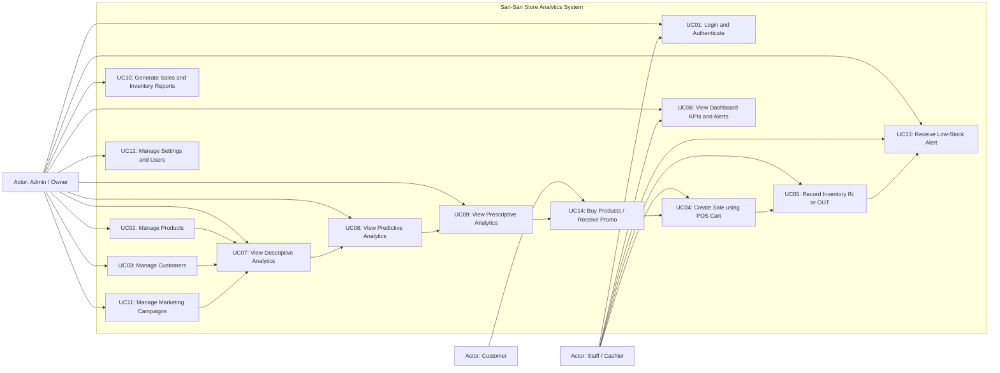

# Use Case Diagram

## SARI-SARI STORE SALES AND INVENTORY ANALYTICS SYSTEM

This use case map is drawn as a Mermaid `flowchart` because the project requires a flowchart/graph-style diagram. It shows the three actors — **Admin/Owner**, **Staff/Cashier**, and **Customer** — and their interactions with the system's use cases.

---

## Actor and Use Case Descriptions

| Actor | Description | Primary use cases |
|---|---|---|
| Admin / Owner | Manages the store, reviews analytics, and makes decisions | UC01, UC02, UC03, UC06–UC13 |
| Staff / Cashier | Handles daily sales and stock movements | UC01, UC04, UC05, UC06, UC13 |
| Customer | Buys products and receives promotions; indirect participant | UC14 |

| Use case | Short description |
|---|---|
| UC01 | Log in with credentials and obtain an authenticated session |
| UC02 | Add, edit, deactivate products and set price/cost/reorder level |
| UC03 | Add and edit customer records and customer type |
| UC04 | Build a POS cart, apply discount, choose payment method, save the sale |
| UC05 | Record stock IN or OUT with reference and note |
| UC06 | View KPI cards, sales trend, and low-stock alerts |
| UC07 | View revenue, trends, top products, segments, and ROAS |
| UC08 | View moving averages, forecasts, seasonality, and risk signals |
| UC09 | View reorder, markdown, budget, and targeting recommendations |
| UC10 | Generate filtered sales and inventory reports |
| UC11 | Add and edit marketing campaign records |
| UC12 | Manage user accounts and store settings |
| UC13 | Receive automatic low-stock / stockout-risk alert |
| UC14 | Purchase products and receive targeted promotional offers |

**Relationships in the diagram:** `UC04 → UC05` means completing a sale automatically records an inventory OUT; `UC05 → UC13` means stock movements update low-stock alerts; `UC07 → UC08 → UC09` shows the step-wise analytics pipeline; `UC09 → UC14` shows prescriptive recommendations producing customer-facing promos; `UC14 → UC04` shows a customer purchase becoming a POS sale.

> **Note:** The diagram uses a flowchart with quoted labels so that punctuation and slashes remain valid Mermaid syntax. Dashed/<<include>> stereotypes are represented as explicit directed links for clarity in common Markdown renderers.
